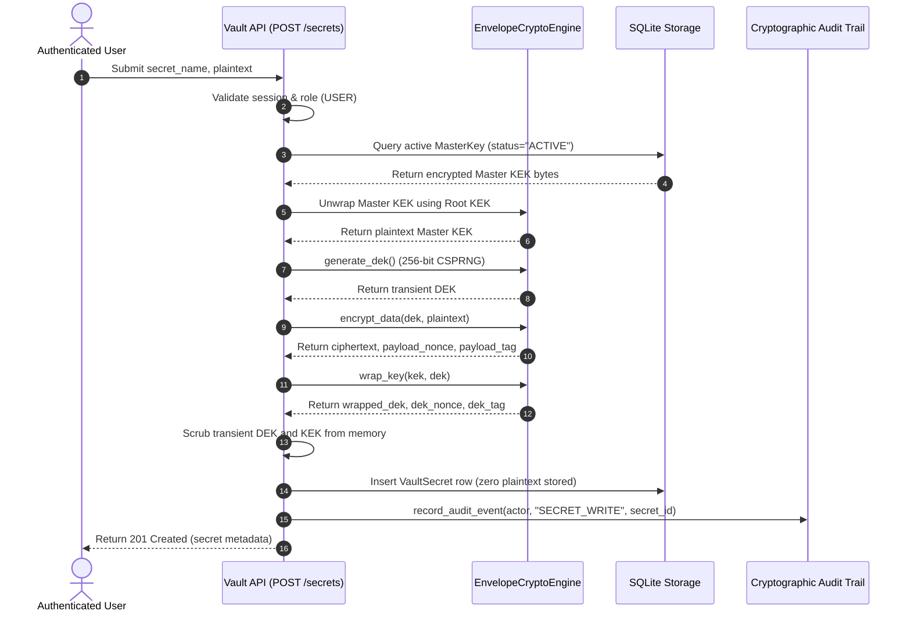
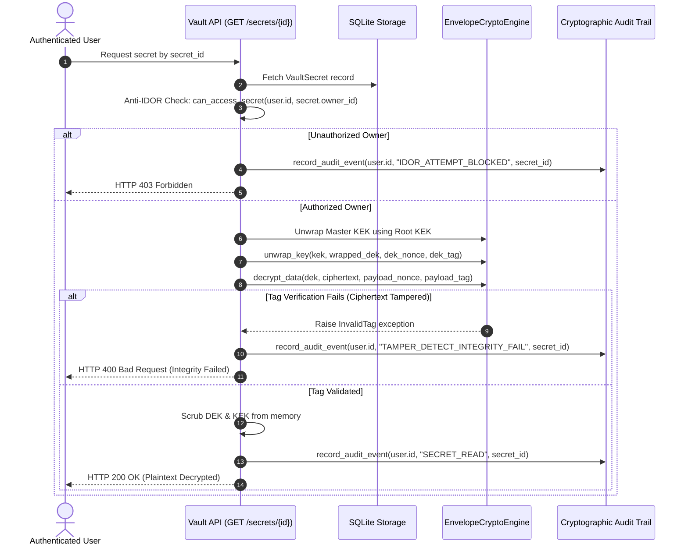

# Technical & Cryptographic Architecture Specification

**Project**: Authenticated Enterprise Key Management Service (KMS) & Secret Vault  
**Academic Program**: ING5 SSIRE (Class of 2026) — *Art of Protecting Secrets* (Track 02: Protect)  
**Authors**: Ahmed Amine Ghenimi & Abdallah Dridi  
**Repository**: [https://github.com/TiiPain/enterprise-kms-vault](https://github.com/TiiPain/enterprise-kms-vault)  

---

## 1. Executive Summary & System Objectives

The **Authenticated Enterprise Key Management Service (KMS) & Secret Vault** is a defense-in-depth security appliance designed to store, manage, and audit enterprise secrets (API tokens, database credentials, TLS certificates) under a strict **Zero-Trust** and **Zero-Knowledge** operational model.

Traditional secret vaults frequently suffer from single-point-of-failure vulnerabilities, where the compromise of a static database key or an overprivileged administrator exposes all tenant data. This system resolves these structural weaknesses by implementing:
1. **Two-Tier Envelope Cryptography**: Decoupling data encryption from key management via transient Data Encryption Keys (DEKs) wrapped under long-lived Key Encryption Keys (KEKs).
2. **Zero-Knowledge Role-Based Access Control (RBAC)**: Enforcing strict non-repudiable boundaries where administrators can manage system state but possess zero technical ability to read or decrypt tenant secrets.
3. **Cryptographically Tamper-Evident Audit Logging**: Mathematically linking every system operation into an immutable SHA-256 hash chain verified with HMAC-SHA256 signatures.
4. **Resilience to Active Threats**: Hardened defenses against Insecure Direct Object References (IDOR/BOLA), brute-force credential stuffing, ciphertext bit-flipping attacks, and clickjacking.

---

## 2. Two-Tier Envelope Cryptography Engine

### 2.1 Cryptographic Primitives & Parameters
* **Symmetric Cipher**: `AES-256-GCM` (Advanced Encryption Standard in Galois/Counter Mode).
* **Key Length**: 256 bits (32 bytes) of cryptographic randomness sourced via `os.urandom()` (operating system CSPRNG).
* **Initialization Vector (Nonce)**: 96 bits (12 bytes) uniquely sampled per encryption call.
* **Authentication Tag**: 128 bits (16 bytes) generated by GHASH over ciphertext and Additional Authenticated Data (AAD).
* **Payload Encoding**: Binary vectors are serialized as URL-safe RFC 4648 Base64 strings for database persistence.

### 2.2 Key Hierarchy & Life-Cycle
The system implements a three-layer hierarchy:

```
[ Root Key Encryption Key (Root KEK) ]  <-- Static 256-bit key from server environment
                   │
                   ▼  (Wraps via AES-256-GCM)
[ Master Key Encryption Key (Master KEK) ] <-- Rotatable KMS Master Keys stored in DB
                   │
                   ▼  (Wraps via AES-256-GCM)
[ Data Encryption Key (DEK) ]             <-- Ephemeral 256-bit key generated per secret write
                   │
                   ▼  (Encrypts via AES-256-GCM)
[ Plaintext Secret Payload ]
```

1. **Root KEK**: Derived from `ROOT_MASTER_KEY_HEX` in environment variables. Used exclusively to unwrap Master KEKs during KMS operations.
2. **Master KEK**: Managed under `MasterKey` records in the database. Each Master KEK has a distinct identifier (e.g., `k-default-root-v1`), version counter, and state (`ACTIVE`, `ROTATED`, `REVOKED`).
3. **Transient DEK**: A fresh 256-bit symmetric key generated in RAM solely for encrypting a single payload. It is immediately wrapped under the active Master KEK, and its plaintext representation is purged from RAM using Python's memory management (`del transient_dek`).

### 2.3 Secret Ingestion & Retrieval Sequence

#### Ingestion Workflow (Write Path)


#### Retrieval Workflow (Read Path)


---

## 3. Key Lifecycle Management & KMS State Machine

The service manages the complete cryptographic lifecycle of Key Encryption Keys:

```
  ┌──────────────┐     Admin Rotate      ┌───────────────┐     Admin Revoke     ┌───────────────┐
  │    ACTIVE    │ ────────────────────> │    ROTATED    │ ───────────────────> │    REVOKED    │
  └──────────────┘                       └───────────────┘                      └───────────────┘
   (Writes & Reads)                       (Reads Only)                           (Access Blocked)
```

1. **ACTIVE**: The primary key utilized for wrapping DEKs on newly created secrets. Only one Master KEK can be active per system tier.
2. **ROTATED**: Superseded by a newer key generation. Existing secrets encrypted under this key remain fully decryptable without data loss, but no new secrets can be written under it.
3. **REVOKED**: Cryptographically decommissioned. All unwrap operations under this key are blocked, rendering associated ciphertexts inaccessible.

---

## 4. Identity, Authentication & Zero-Knowledge RBAC

### 4.1 Password Hashing via Argon2id
To withstand offline password cracking via GPU and ASIC farms, user credentials are processed with **Argon2id** (the winner of the Password Hashing Competition) using memory-hard parameters:
* **Memory Cost ($m$)**: $65,536\text{ KiB} = 64\text{ MB}$.
* **Time Cost ($t$)**: 2 iterations.
* **Parallelism ($p$)**: 2 lanes.
* **Salt**: 16 bytes generated by a cryptographically secure random source.
* **Hash Output**: 32 bytes formatted in standard encoded Argon2 syntax.

### 4.2 Brute-Force Defense & Automated Lockout
* Every failed login increments `failed_login_attempts` in the `users` table.
* Reaching **5 consecutive failed attempts** activates an automated **15-minute account lockout** (`locked_until = now + 15 min`).
* Subsequent authentication attempts during the lockout window are rejected with `HTTP 403 Forbidden` without evaluating password hashes (mitigating CPU exhaustion).
* Every lockout event triggers an immutable audit log entry (`ACCOUNT_LOCKOUT`).
* A successful authentication resets `failed_login_attempts` to 0.

### 4.3 Zero-Knowledge Access Control Matrix

| Role | Manage KMS Keys | View Audit Logs | Verify Audit Chain | Create Secrets | Read Own Secrets | Read Other Secrets |
| :--- | :---: | :---: | :---: | :---: | :---: | :---: |
| **GUEST** | ❌ | ❌ | ❌ | ❌ | ❌ | ❌ |
| **USER** | ❌ | ❌ | ❌ | ✅ | ✅ | ❌ *(HTTP 403 IDOR)* |
| **AUDITOR** | ❌ | ✅ | ✅ | ❌ | ❌ | ❌ *(Zero-Knowledge)* |
| **ADMIN** | ✅ | ✅ | ✅ | ❌ | ❌ | ❌ *(Zero-Knowledge)* |

* **Zero-Knowledge Admin Guarantee**: Administrators are strictly restricted to operational maintenance (key rotation, account status, audit verification). Direct attempts by an Admin to call `GET /api/v1/secrets` or `GET /api/v1/secrets/{id}` are rejected with `HTTP 403 Forbidden`.
* **Anti-IDOR Ownership Guard**: Evaluated at [`app/core/rbac.py`](file:///c:/Users/TiiPain/Downloads/Enterprise_KMS_Vault/app/core/rbac.py):
  $$\text{Access Granted} \iff (\text{role} == \text{"USER"}) \land (\text{user\_id} == \text{owner\_id})$$

---

## 5. Cryptographically Tamper-Evident Audit Trail

### 5.1 Sequential Hash Chaining Formula
Audit logs form an immutable forward-linked cryptographic chain. Each record calculates its hash $H_i$ over the previous record's hash and its own canonical fields:

$$H_0 = \text{"0"}^{64} \quad (\text{Genesis Hash})$$

$$H_i = \text{SHA-256}\Big(H_{i-1} \parallel \text{timestamp} \parallel \text{actor\_id} \parallel \text{action} \parallel \text{resource\_id}\Big)$$

Where:
* $\parallel$ denotes string concatenation.
* `timestamp` is standardized to ISO-8601 UTC format (`YYYY-MM-DDTHH:MM:SSZ`).
* `resource_id` defaults to `"NONE"` when omitted.

### 5.2 HMAC-SHA256 Authenticity Signatures
To prevent an attacker with write access to the database from rewriting the entire SHA-256 chain, every entry is signed using HMAC-SHA256:

$$\text{HMAC}_i = \text{HMAC}_{\text{SHA-256}}\Big(\text{AUDIT\_HMAC\_SECRET},\, H_i\Big)$$

### 5.3 Chain Verification Algorithm ($O(N)$)
The verification endpoint (`POST /api/v1/audit/verify`) executes the following checks:
1. Iterates from record $1$ to $N$ ordered by primary key ID.
2. Recomputes $H_i' = \text{SHA-256}(H_{i-1} \parallel \dots)$ and compares it against stored $H_i$. Any discrepancy flags intermediate record tampering or deleted records.
3. Recomputes $\text{HMAC}_i'$ using the server's secret key and compares it against stored $\text{HMAC}_i$. Any discrepancy flags unauthorized modification of log contents.

---

## 6. Database Schema & Persistence Model

The relational schema is implemented in SQLite via SQLAlchemy with foreign key integrity enabled:

```
┌─────────────────────────┐         ┌─────────────────────────┐
│          users          │         │       master_keys       │
├─────────────────────────┤         ├─────────────────────────┤
│ id (PK, String)         │         │ id (PK, String)         │
│ username (Unique)       │         │ key_name (String)       │
│ email (Unique)          │         │ key_version (Integer)   │
│ password_hash (String)  │         │ encrypted_key_bytes     │
│ role (String)           │         │ status (String)         │
│ failed_login_attempts   │         │ created_at (DateTime)   │
│ locked_until (DateTime) │         └────────────┬────────────┘
└────────────┬────────────┘                      │
             │ 1                                 │ 1
             │                                   │
             │ N                                 │ N
┌────────────▼───────────────────────────────────▼────────────┐
│                        vault_secrets                        │
├─────────────────────────────────────────────────────────────┤
│ id (PK, String, sec-xxx)                                    │
│ owner_id (FK -> users.id, ON DELETE CASCADE)                │
│ key_id (FK -> master_keys.id, ON DELETE RESTRICT)           │
│ secret_name (String)                                        │
│ encrypted_payload (Text, Base64 AES-256-GCM ciphertext)     │
│ payload_nonce (String, 12-byte Base64)                      │
│ payload_tag (String, 16-byte Base64)                        │
│ encrypted_dek (Text, Base64 wrapped DEK)                    │
│ dek_nonce (String, 12-byte Base64)                          │
│ dek_tag (String, 16-byte Base64)                            │
│ created_at (DateTime)                                       │
│ updated_at (DateTime)                                       │
└─────────────────────────────────────────────────────────────┘

┌─────────────────────────────────────────────────────────────┐
│                         audit_logs                          │
├─────────────────────────────────────────────────────────────┤
│ id (PK, Integer Auto-Increment)                             │
│ actor_id (String)                                           │
│ action (String)                                             │
│ resource_id (String, Nullable)                              │
│ timestamp (DateTime)                                        │
│ previous_record_hash (String, 64-char Hex)                  │
│ record_hmac (String, 64-char Hex)                           │
└─────────────────────────────────────────────────────────────┘
```

---

## 7. HTTP Security Hardening & Defenses

Every HTTP response from the FastAPI application includes defensive headers configured via global middleware:
* `X-Frame-Options: DENY`: Prevents UI redressing and Clickjacking attacks.
* `X-Content-Type-Options: nosniff`: Prevents MIME-type confusion attacks.
* `X-XSS-Protection: 1; mode=block`: Activates browser cross-site scripting filters.
* `Strict-Transport-Security: max-age=31536000; includeSubDomains`: Mandates HTTPS transport.
* `Referrer-Policy: strict-origin-when-cross-origin`: Restricts referrer leakage.
* `Content-Security-Policy`: Restricts script and asset execution to trusted origins.
